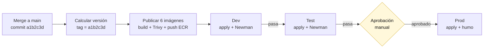

# CD: promoción Dev → Test → Prod

El CD (`.github/workflows/cd.yml`) corre en cada merge a `main` y lleva **la misma imagen** por los tres ambientes. Los pasos del despliegue están escritos una sola vez en `.github/workflows/deploy.yml` (workflow reutilizable) y el CD los llama tres veces.

## Qué hace cada despliegue (`deploy.yml`)

| Paso | Para qué |
| ---- | -------- |
| Verificar que el ambiente esté levantado | El CD **no crea** ambientes de cero (RDS + Redis + 2 ALB cuestan y llevan ~15 min, y la base hay que inicializarla). Si el cluster no existe, falla con un mensaje claro. |
| `terraform plan` + `terraform apply` con `image_tag=<sha>` | Actualiza la imagen de las 6 task definitions. ECS hace el deploy gradual (la versión vieja atiende hasta que la nueva está sana). |
| `aws ecs wait services-stable` | Espera a que los 6 servicios terminen el deploy. |
| Verificar la versión | Comprueba que los 6 servicios corren **exactamente** el tag nuevo. Si el circuit breaker hizo rollback, el servicio queda "estable" pero con la versión vieja: este paso lo detecta y corta la promoción. |
| Newman (dev y test) | La misma colección del CI (`tests/integration`), ahora contra el ALB del ambiente. Recorre la compra completa. |
| Prueba de humo (prod) | Solo lectura (página principal y catálogo). No se corre la colección completa para no crear compras falsas en la tienda real. |

## Quality gates del recorrido

| Gate | Dónde | Si falla |
| ---- | ----- | -------- |
| Build, Trivy, Gitleaks, Semgrep, SCA, SonarCloud, Newman | CI del PR (obligatorios en el ruleset, rama al día) | No se puede mergear |
| Trivy sobre la imagen final | `publish` | La imagen no se publica y no se despliega nada |
| Deploy correcto + Newman en dev | `deploy-dev` | No pasa a test |
| Deploy correcto + Newman en test | `deploy-test` | No pasa a prod |
| Aprobación manual | environment `prod` (required reviewers) | No pasa a prod |

## Operación

**Antes de mergear (para que el CD despliegue):** con el Learner Lab iniciado, actualizar los secrets `AWS_ACCESS_KEY_ID`, `AWS_SECRET_ACCESS_KEY` y `AWS_SESSION_TOKEN` del repo y tener levantados los ambientes a los que se quiere llegar (`docs/infra/despliegue-ecs.md`, sección 11).

**Si un job falló porque el ambiente estaba apagado o las credenciales vencieron:** levantar el ambiente o actualizar los secrets y, en la corrida, usar **Re-run failed jobs**. Se re-ejecuta solo lo que falló, con el mismo commit y el mismo tag. (No usar "Re-run all jobs": volvería a publicar las imágenes con un tag que ya existe en ECR.)

**Aprobar prod:** en la corrida del CD aparece *Review deployments* → marcar `prod` → *Approve and deploy*. Las credenciales se leen al aprobar: si el lab se reinició, actualizar los secrets antes.

**Qué versión corre en cada ambiente:** pestaña *Deployments* del repo (cada ambiente muestra su último deploy y su URL), el resumen de cada corrida del CD, o `terraform output image_tag` en el workspace del ambiente.

**Rollback a una versión anterior:** volver a correr el job del ambiente en una corrida vieja del CD (re-run del job `Dev`, `Test` o `Prod` de esa corrida) o, a mano, `terraform apply -var-file=envs/<env>.tfvars -var="image_tag=<sha viejo>"`.
