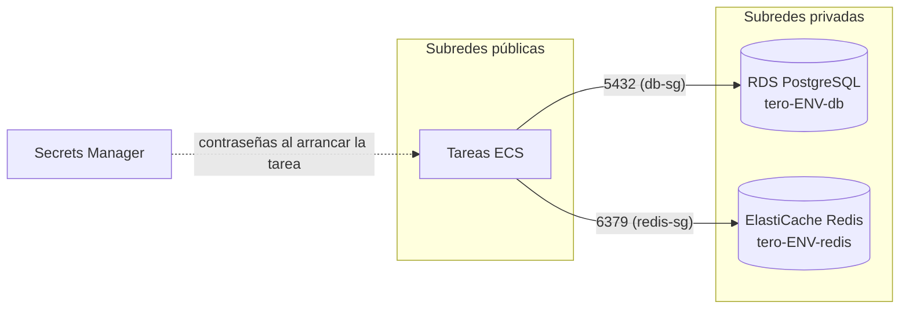

# Base de datos, Redis y secretos

En local, `docker compose` levanta PostgreSQL y Redis como contenedores. En AWS se reemplazan
por servicios gestionados (AWS se encarga de instalarlos, parchearlos y hacer backups), y las
contraseñas pasan del archivo `.env` a **AWS Secrets Manager**.

| Local (docker compose) | AWS                            | Módulo Terraform           |
| ---------------------- | ------------------------------ | -------------------------- |
| `postgres:16`          | RDS PostgreSQL 16              | `infra/modules/database`   |
| `redis:7-alpine`       | ElastiCache Redis 7.1 (1 nodo) | `infra/modules/cache`      |
| `.env`                 | Secrets Manager                | `infra/modules/secrets` + RDS |



## Secretos

| Secreto                             | Lo crea   | Claves                               | Lo usan                     |
| ----------------------------------- | --------- | ------------------------------------ | --------------------------- |
| `rds!db-...` (ARN en `db_secret_arn`) | RDS       | `username`, `password`               | catalog, carts, orders, admin |
| `tero/ENV/admin`                    | Terraform | `ADMIN_PASSWORD`, `ADMIN_JWT_SECRET` | admin                       |

Variables de entorno de cada servicio en ECS (las de `secrets` se leen de Secrets Manager al
arrancar la tarea; el resto son valores normales):

| Servicio | Variable                                 | Valor                                  |
| -------- | ---------------------------------------- | -------------------------------------- |
| catalog  | `RETAIL_CATALOG_PERSISTENCE_ENDPOINT`    | output `db_endpoint`                   |
|          | `RETAIL_CATALOG_PERSISTENCE_USER`        | output `db_username`                   |
|          | `RETAIL_CATALOG_PERSISTENCE_PASSWORD`    | secret `db_secret_arn:password::`      |
| carts    | `CART_POSTGRES_HOST`                     | output `db_address`                    |
|          | `CART_POSTGRES_USER`                     | output `db_username`                   |
|          | `CART_POSTGRES_PASSWORD`                 | secret `db_secret_arn:password::`      |
| orders   | `RETAIL_ORDERS_PERSISTENCE_ENDPOINT`     | output `db_endpoint`                   |
|          | `RETAIL_ORDERS_PERSISTENCE_USERNAME`     | output `db_username`                   |
|          | `RETAIL_ORDERS_PERSISTENCE_PASSWORD`     | secret `db_secret_arn:password::`      |
| checkout | `RETAIL_CHECKOUT_PERSISTENCE_REDIS_URL`  | output `redis_url`                     |
| admin    | `DB_HOST`                                | output `db_address`                    |
|          | `DB_USER`                                | output `db_username`                   |
|          | `DB_PASSWORD`                            | secret `db_secret_arn:password::`      |
|          | `ADMIN_USERNAME`                         | `admin` (no es secreto)                |
|          | `ADMIN_PASSWORD`                         | secret `admin_secret_arn:ADMIN_PASSWORD::`   |
|          | `ADMIN_JWT_SECRET`                       | secret `admin_secret_arn:ADMIN_JWT_SECRET::` |

Ejemplo en una task definition:

```hcl
secrets = [
  { name = "RETAIL_CATALOG_PERSISTENCE_PASSWORD", valueFrom = "${var.db_secret_arn}:password::" }
]
```

El rol de ejecución de la tarea (en Learner Lab, `LabRole`) necesita `secretsmanager:GetSecretValue`
sobre esos ARN.

## Configuración por ambiente

| Configuración        | dev / test | prod  | Motivo                                                        |
| -------------------- | ---------- | ----- | ------------------------------------------------------------- |
| Instancia RDS        | db.t3.micro | db.t3.micro | La más chica que permite Learner Lab                   |
| Multi-AZ             | No         | Sí    | En prod, si se cae una zona la base sigue en la otra          |
| Backups automáticos  | 1 día      | 7 días | En prod se puede volver a cualquier punto de la última semana |
| Snapshot al destruir | No         | Sí    | En prod no se pierden datos por un `destroy`                  |
| Nodo Redis           | cache.t3.micro | cache.t3.micro | Checkout guarda datos temporales y pocos         |

## Decisiones

- **La contraseña de la base la maneja RDS** (`manage_master_user_password`). RDS la genera, la
  guarda en Secrets Manager y la rota sola cada 7 días. Terraform nunca la ve, así que no queda en
  el código ni en el state.
- **Rotación de la contraseña de la base.** Las tareas de ECS leen el secreto solo al arrancar.
  Cuando RDS rota la contraseña, hay que reiniciar los servicios para que tomen la nueva:
  `aws ecs update-service --cluster <cluster> --service <servicio> --force-new-deployment`.
- **Los secretos de admin los genera Terraform** con `random_password`. Nadie los escribe a mano
  y no están en el repositorio. Sí quedan en el state, que está en S3 cifrado y sin acceso
  público (ver `backend.md`). Para entrar al panel se lee la contraseña con
  `aws secretsmanager get-secret-value --secret-id tero/dev/admin`.
- **SSL de PostgreSQL desactivado** (`rds.force_ssl = 0`). catalog y orders tienen
  `sslmode=disable` fijo en el código. El tráfico no sale de la VPC y el security group solo deja
  entrar a ECS. Mejora: pasar los servicios a `sslmode=require` y poner `force_ssl = true`.
- **Redis sin cifrado ni contraseña.** Vive en subredes privadas y solo acepta tráfico desde
  `ecs-sg`. Checkout ya soporta `rediss://` si se quiere activar cifrado en tránsito.
- **`recovery_window_in_days = 0`.** Si no, al destruir un secreto AWS lo deja "pendiente de
  borrado" hasta 30 días y no deja volver a crear otro con el mismo nombre (pasa seguido al
  reiniciar el Learner Lab).
- **Sin Performance Insights ni Enhanced Monitoring.** Necesitan roles de IAM que Learner Lab no
  deja crear. Las métricas básicas de RDS igual llegan a CloudWatch.

## Inicializar la base

RDS crea solo la base `orders`. Las bases `catalogdb` y `cartdb` y la tabla `cart_items` las crea
`init-db.sql` (el mismo de docker compose). Como la base está en una subred privada, el script se
corre una vez desde una tarea de ECS en la VPC, cuando exista el cluster (#20), con la imagen
`postgres:16-alpine` y estas variables:

| Variable     | Valor                                   |
| ------------ | --------------------------------------- |
| `PGHOST`     | output `db_address`                     |
| `PGUSER`     | output `db_username`                    |
| `PGDATABASE` | `orders`                                |
| `PGPASSWORD` | secret `db_secret_arn:password::`       |
| `INIT_SQL`   | contenido de `init-db.sql`              |

Comando: `sh -c 'printf "%s" "$INIT_SQL" | psql'`. Las tablas de catalog y orders las crean los
propios servicios al arrancar (AutoMigrate).

## Hallazgos de Checkov

`checkov -d infra/modules/database -d infra/modules/cache -d infra/modules/secrets`: 12 checks
pasan y 9 fallan. Los que fallan son decisiones tomadas:

| Check        | Qué pide                                  | Por qué no se aplica                                                                 |
| ------------ | ----------------------------------------- | ------------------------------------------------------------------------------------ |
| CKV_AWS_157  | RDS Multi-AZ                              | Se activa por tfvars solo en prod (`db_multi_az = true`); en dev/test duplica el costo |
| CKV_AWS_293  | Protección contra borrado                 | Por tfvars; en Learner Lab hay que poder destruir todo                               |
| CKV_AWS_353  | Performance Insights                      | Necesita permisos que Learner Lab no da                                              |
| CKV_AWS_118  | Enhanced Monitoring                       | Necesita crear un rol de IAM (Learner Lab no deja)                                   |
| CKV_AWS_161  | Autenticación IAM a la base               | Los servicios usan usuario y contraseña; habría que cambiar su código                |
| CKV2_AWS_69  | SSL obligatorio en la base                | catalog y orders usan `sslmode=disable` fijo (ver Decisiones)                        |
| CKV_AWS_134  | Backups de Redis                          | Checkout guarda datos temporales; no vale la pena el costo                           |
| CKV_AWS_149  | Secreto cifrado con una llave KMS propia  | Se usa la llave administrada por AWS (`aws/secretsmanager`), que ya cifra el secreto |
| CKV2_AWS_57  | Rotación automática del secreto de admin  | Rotarlo exige una Lambda propia; se rota a mano (ver runbook)                        |

## Evidencia

AGREGAR EVIDENCIA
