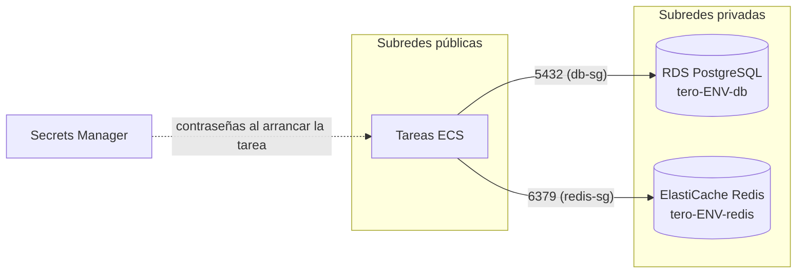
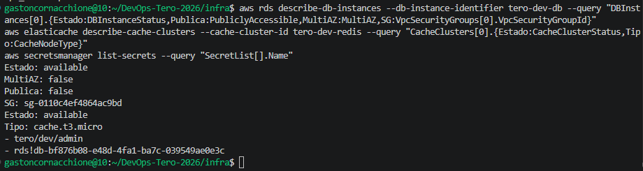

# Base de datos, Redis y secretos

En local, `docker compose` levanta PostgreSQL y Redis como contenedores. En AWS se reemplazan
por servicios gestionados (AWS se encarga de instalarlos, parchearlos y hacer backups), y las
contraseñas pasan del archivo `.env` a **AWS Secrets Manager**.

| Local (docker compose) | AWS                            | Módulo Terraform           |
| ---------------------- | ------------------------------ | -------------------------- |
| `postgres:16`          | RDS PostgreSQL 16              | `infra/modules/database`   |
| `redis:7-alpine`       | ElastiCache Redis 7.1 (1 nodo) | `infra/modules/cache`      |
| `.env`                 | Secrets Manager                | `infra/modules/database` + `infra/modules/secrets` |
| `init-db.sql` al arrancar Postgres | Tarea única de ECS `tero-ENV-init-db` | `infra/init-db.tf` |



## Bases dentro de RDS

RDS es **un solo servidor** de PostgreSQL con **tres bases**, igual que en docker compose:

| Base | La crea | Tablas | La usan |
| ---- | ------- | ------ | ------- |
| `orders` | RDS al nacer (`db_name`) | Las crea orders al arrancar (AutoMigrate) | orders, admin |
| `catalogdb` | `init-db.sql` | Las crea catalog al arrancar (AutoMigrate) | catalog, admin |
| `cartdb` | `init-db.sql` | `cart_items`, creada por `init-db.sql` | carts |

## Secretos

| Secreto | Lo crea | Claves | Lo usan |
| ------- | ------- | ------ | ------- |
| `tero-ENV/db` (ARN en `db_secret_arn`) | Terraform (módulo `database`) | `username`, `password` | catalog, carts, orders, admin, init-db |
| `tero/ENV/admin` (ARN en `admin_secret_arn`) | Terraform (módulo `secrets`) | `ADMIN_PASSWORD`, `ADMIN_JWT_SECRET` | admin |

Las contraseñas las genera Terraform con `random_password`: nadie las escribe ni las ve, y no
están en el repositorio. ECS las lee de Secrets Manager al arrancar cada tarea y se las pasa al
contenedor como variables de entorno.

Variables de entorno de cada servicio en ECS (las de `secrets` se leen de Secrets Manager al
arrancar la tarea; el resto son valores normales). Están en `infra/services.tf`:

| Servicio | Variable                                 | Valor                                  |
| -------- | ---------------------------------------- | -------------------------------------- |
| catalog  | `RETAIL_CATALOG_PERSISTENCE_ENDPOINT`    | output `db_endpoint`                   |
|          | `RETAIL_CATALOG_PERSISTENCE_USER`        | output `db_username`                   |
|          | `RETAIL_CATALOG_PERSISTENCE_PASSWORD`    | secret `db_secret_arn:password::`      |
| carts    | `CART_POSTGRES_HOST`                     | output `db_address`                    |
|          | `CART_POSTGRES_USER`                     | output `db_username`                   |
|          | `CART_POSTGRES_PASSWORD`                 | secret `db_secret_arn:password::`      |
| orders   | `RETAIL_ORDERS_PERSISTENCE_ENDPOINT`     | output `db_endpoint`                   |
|          | `RETAIL_ORDERS_PERSISTENCE_USERNAME`     | output `db_username`                   |
|          | `RETAIL_ORDERS_PERSISTENCE_PASSWORD`     | secret `db_secret_arn:password::`      |
| checkout | `RETAIL_CHECKOUT_PERSISTENCE_REDIS_URL`  | output `redis_url`                     |
| admin    | `DB_HOST`                                | output `db_address`                    |
|          | `DB_USER`                                | output `db_username`                   |
|          | `DB_PASSWORD`                            | secret `db_secret_arn:password::`      |
|          | `ADMIN_USERNAME`                         | `admin` (no es secreto)                |
|          | `ADMIN_PASSWORD`                         | secret `admin_secret_arn:ADMIN_PASSWORD::`   |
|          | `ADMIN_JWT_SECRET`                       | secret `admin_secret_arn:ADMIN_JWT_SECRET::` |

Ejemplo en `services.tf`:

```hcl
secrets = {
  RETAIL_CATALOG_PERSISTENCE_PASSWORD = "${module.database.master_secret_arn}:password::"
}
```

Lo que va después del ARN (`:password::`) indica qué clave del JSON del secreto se usa.
El rol de ejecución de la tarea (en Learner Lab, `LabRole`) es el que lee el secreto.

## Configuración por ambiente

| Configuración        | dev / test | prod  | Motivo                                                        |
| -------------------- | ---------- | ----- | ------------------------------------------------------------- |
| Instancia RDS        | db.t3.micro | db.t3.micro | La más chica que permite Learner Lab                   |
| Multi-AZ             | No         | Sí    | En prod, si se cae una zona la base sigue en la otra          |
| Backups automáticos  | 1 día      | 7 días | En prod se puede volver a cualquier punto de la última semana |
| Snapshot al destruir | No         | No¹   | ¹En Learner Lab se destruye y recrea seguido. En una cuenta real de producción iría `Sí` |
| Protección contra borrado | No    | No¹   | ¹Ídem: en una cuenta real de producción iría `Sí`             |
| Nodo Redis           | cache.t3.micro | cache.t3.micro | Checkout guarda datos temporales y pocos         |

## Decisiones

- **La contraseña de la base la genera Terraform, solo con letras y números.** Al principio se
  usaba `manage_master_user_password` (RDS genera la contraseña y la guarda en Secrets Manager).
  Se descartó por dos motivos:
  1. **La contraseña de RDS incluía el símbolo `$`**, y catalog lee sus variables con
     `go-envconfig` v0.1.1, que interpreta `$NOMBRE` como otra variable de entorno y la
     reemplaza. La contraseña llegaba alterada y la base respondía
     `password authentication failed`. Ver "Lecciones aprendidas".
  2. **RDS rota esa contraseña sola cada 7 días**, y los servicios la leen solo al arrancar: a la
     semana todos habrían quedado con una contraseña vieja.

  Ahora la contraseña se genera con `random_password` (`special = false`) y se guarda en el
  secreto `tero-ENV/db` con las mismas claves que usaba RDS (`username`, `password`), así que los
  servicios no cambiaron.
- **Las contraseñas quedan en el state de Terraform**, que está en S3 cifrado y sin acceso
  público (ver `backend.md`). Se cumple el requisito de no guardar valores sensibles en el state
  **sin cifrar**. Mejora: `ephemeral "random_password"` + argumentos *write-only*
  (`password_wo`, `secret_string_wo`) para que tampoco queden en el state.
- **Rotación de contraseñas, a mano.** Para rotar la de la base:
  `terraform apply -var-file=envs/<env>.tfvars -replace=module.database.random_password.master`
  y después reiniciar los servicios que la usan (catalog, carts, orders, admin):
  `aws ecs update-service --cluster tero-<env>-cluster --service <servicio> --force-new-deployment`.
  La de admin se rota igual, con `-replace=module.secrets.random_password.admin_password`.
- **Para entrar al panel de admin**, la contraseña se lee de Secrets Manager:
  `aws secretsmanager get-secret-value --secret-id tero/dev/admin --query SecretString --output text`.
- **SSL de PostgreSQL desactivado** (`rds.force_ssl = 0`). catalog y orders tienen
  `sslmode=disable` fijo en el código. El tráfico no sale de la VPC y el security group solo deja
  entrar a ECS. Mejora: pasar los servicios a `sslmode=require` y poner `force_ssl = true`.
- **Redis sin cifrado ni contraseña.** Vive en subredes privadas y solo acepta tráfico desde
  `ecs-sg`. Checkout ya soporta `rediss://` si se quiere activar cifrado en tránsito.
- **`recovery_window_in_days = 0`** en los secretos. Si no, al destruir un secreto AWS lo deja
  "pendiente de borrado" hasta 30 días y no deja volver a crear otro con el mismo nombre (pasa
  seguido al recrear el ambiente en el Learner Lab).
- **Sin Performance Insights ni Enhanced Monitoring.** Necesitan roles de IAM que Learner Lab no
  deja crear. Las métricas básicas de RDS igual llegan a CloudWatch, y los logs de PostgreSQL
  también (`enabled_cloudwatch_logs_exports`).

## Inicializar la base

RDS crea solo la base `orders`. En docker compose, Postgres corría `init-db.sql` solo al arrancar
por primera vez; RDS no tiene esa función. Por eso hay una **tarea única de ECS**
(`infra/init-db.tf`) que prende un contenedor `postgres:16-alpine` dentro de la VPC, corre
`init-db.sql` (el mismo archivo que usa docker compose) contra RDS y se apaga.

Se corre **una vez cada vez que se crea RDS** (por ejemplo, después de `terraform destroy` +
`terraform apply`):

```bash
cd infra
$(terraform output -raw init_db_command)   # corre la tarea
aws logs tail /ecs/tero-dev/init-db        # ver qué hizo (1 o 2 minutos después)
```

En los logs tienen que aparecer `CREATE DATABASE` (dos veces), los `GRANT` y `CREATE TABLE`.
Después, reiniciar los servicios que arrancaron antes de que existieran sus bases:

```bash
aws ecs update-service --cluster tero-dev-cluster --service catalog --force-new-deployment
aws ecs update-service --cluster tero-dev-cluster --service carts --force-new-deployment
aws ecs update-service --cluster tero-dev-cluster --service admin --force-new-deployment
```

Cómo funciona la tarea:

| Variable del contenedor | Valor |
| ----------------------- | ----- |
| `PGHOST`     | output `db_address`                     |
| `PGPORT`     | `5432`                                  |
| `PGUSER`     | output `db_username`                    |
| `PGDATABASE` | `orders`                                |
| `PGPASSWORD` | secret `db_secret_arn:password::`       |
| `INIT_SQL`   | contenido de `init-db.sql` (lo lee Terraform con `file()`) |

Comando del contenedor: `sh -c "printf '%s' \"$INIT_SQL\" | psql"` (escribe el script y se lo
pasa a `psql`).

Mejora: empaquetar `init-db.sql` en una imagen propia construida por el CI, o usar una
herramienta de migraciones (Flyway, Liquibase).

## Lecciones aprendidas

- **Una contraseña con `$` rompió catalog.** Funcionaba en local porque la contraseña del `.env`
  no tenía símbolos. En AWS, la generada por RDS sí, y la librería de configuración de catalog
  la alteraba. Se diagnosticó con los logs en CloudWatch (`password authentication failed`
  mientras init-db, con la misma contraseña, se conectaba bien) y revisando el código de la
  librería. Conclusión: probar con contraseñas como las de producción, y generar secretos con un
  juego de caracteres que todos los consumidores soporten.

## Hallazgos de Checkov

`checkov -d infra/modules/database -d infra/modules/cache -d infra/modules/secrets`: 12 checks
pasan y 9 fallan. Los que fallan son decisiones tomadas:

| Check        | Qué pide                                  | Por qué no se aplica                                                                 |
| ------------ | ----------------------------------------- | ------------------------------------------------------------------------------------ |
| CKV_AWS_157  | RDS Multi-AZ                              | Se activa por tfvars solo en prod (`db_multi_az = true`); en dev/test duplica el costo |
| CKV_AWS_293  | Protección contra borrado                 | Por tfvars; en Learner Lab hay que poder destruir todo                               |
| CKV_AWS_353  | Performance Insights                      | Necesita permisos que Learner Lab no da                                              |
| CKV_AWS_118  | Enhanced Monitoring                       | Necesita crear un rol de IAM (Learner Lab no deja)                                   |
| CKV_AWS_161  | Autenticación IAM a la base               | Los servicios usan usuario y contraseña; habría que cambiar su código                |
| CKV2_AWS_69  | SSL obligatorio en la base                | catalog y orders usan `sslmode=disable` fijo (ver Decisiones)                        |
| CKV_AWS_134  | Backups de Redis                          | Checkout guarda datos temporales; no vale la pena el costo                           |
| CKV_AWS_149  | Secreto cifrado con una llave KMS propia  | Se usa la llave administrada por AWS (`aws/secretsmanager`), que ya cifra el secreto |
| CKV2_AWS_57  | Rotación automática de secretos           | Rotarlos automáticamente exige una Lambda propia; se rotan a mano (ver Decisiones)   |

## Evidencia



