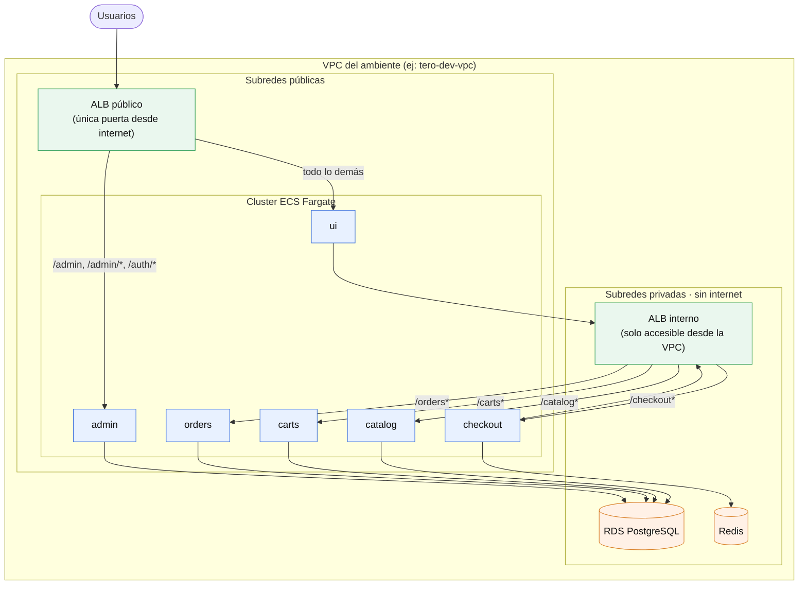
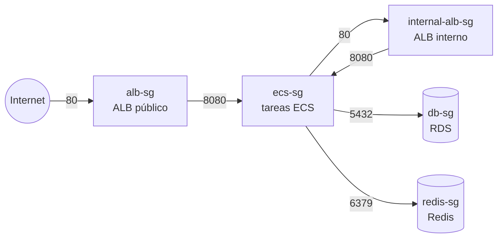
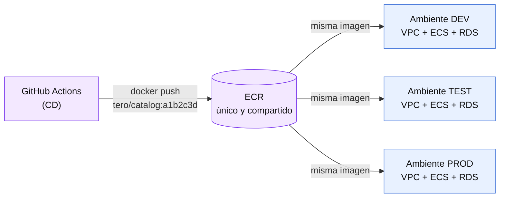
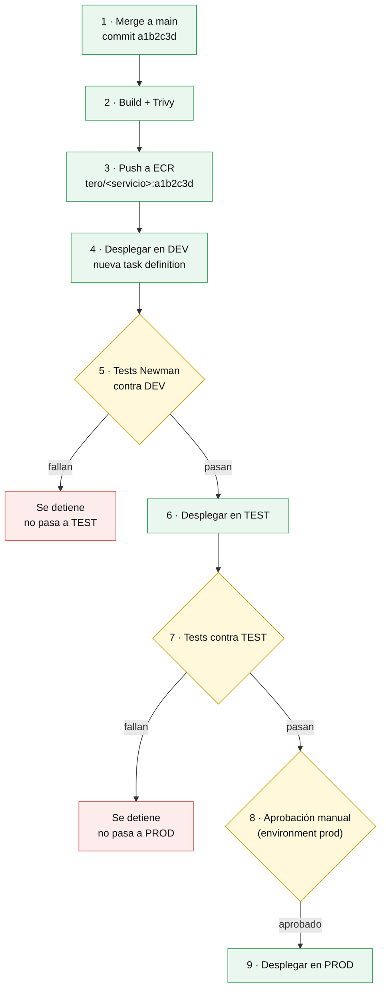
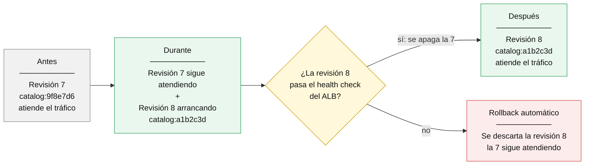

# Despliegue en ECS

Diagramas y decisiones del despliegue de Tero en AWS (ECS Fargate + ECR). GitHub dibuja los diagramas automáticamente a partir del código Mermaid.

Código Terraform relacionado:

| Qué                                                         | Dónde                        |
| ----------------------------------------------------------- | ---------------------------- |
| Cluster ECS y `LabRole`                                     | `infra/ecs.tf`               |
| ALB público (usuarios → ui / admin)                         | `infra/modules/alb`          |
| ALB interno (servicio → servicio)                           | `infra/modules/internal-alb` |
| Molde de un microservicio (logs, task definition, servicio) | `infra/modules/ecs-service`  |
| Los 6 servicios y sus variables                             | `infra/services.tf`          |
| Security groups                                             | `infra/modules/security`     |

## 1. Tero corriendo en un ambiente



- El **ALB público** es la única entrada desde internet. Las rutas del panel (`/admin`, `/admin/*`, `/auth/*`) van a **admin** y todo lo demás a la tienda (**ui**).
- **catalog, carts, checkout y orders no son accesibles desde internet.** Solo se llega a ellos a través del **ALB interno**.
- **ui** y **checkout** llaman a los otros servicios por el ALB interno, que reparte según la ruta.
- RDS y Redis están en subredes privadas y solo aceptan conexiones de las tareas de ECS.

### Cómo llega un pedido, paso a paso

Ejemplo: el usuario abre la lista de productos.

```
1. Navegador ──► ALB público        GET /api/catalog/products
2. ALB público ──► ui               (no es /admin ni /auth → regla por defecto)
3. ui ──► ALB interno               GET /catalog/products   (ui agrega el prefijo /catalog)
4. ALB interno ──► catalog          (regla /catalog*)
5. catalog ──► RDS                  consulta a la base catalogdb
```

### URLs

| Para qué                | URL                          | Cómo obtenerla               |
| ----------------------- | ---------------------------- | ---------------------------- |
| Tienda                  | `http://<alb-publico>/`      | `terraform output app_url`   |
| Panel de administración | `http://<alb-publico>/admin` | `terraform output admin_url` |

## 2. Comunicación entre servicios: ALB interno

### Por qué no Service Connect

En `docker compose`, los servicios se llaman por nombre (`http://catalog:8080`). En ECS, lo equivalente es **Service Connect**, que necesita un _namespace_ de **AWS Cloud Map**. **El Learner Lab bloquea Cloud Map**: tanto `servicediscovery:CreateHttpNamespace` como `servicediscovery:CreatePrivateDnsNamespace` devuelven `AccessDeniedException`.

### La alternativa: un ALB interno

Cada servicio interno responde bajo **su propio prefijo de ruta** (lo confirmamos en el código), así que un ALB interno puede repartir por ruta sin cambiar el código:

| Servicio                | Rutas que atiende          | Target group           |
| ----------------------- | -------------------------- | ---------------------- |
| catalog                 | `/catalog`, `/catalog/*`   | `tero-ENV-catalog-tg`  |
| carts                   | `/carts`, `/carts/*`       | `tero-ENV-carts-tg`    |
| checkout                | `/checkout`, `/checkout/*` | `tero-ENV-checkout-tg` |
| orders                  | `/orders`, `/orders/*`     | `tero-ENV-orders-tg`   |
| _(cualquier otra ruta)_ | —                          | Respuesta fija `404`   |

Las variables de entorno que en el compose apuntaban a `http://catalog:8080`, `http://carts:8080`, etc. apuntan ahora **todas a la misma dirección**: la del ALB interno. La ruta decide a qué servicio llega.

| Variable                           | docker compose         | AWS                    |
| ---------------------------------- | ---------------------- | ---------------------- |
| `RETAIL_UI_ENDPOINTS_CATALOG`      | `http://catalog:8080`  | `http://<alb-interno>` |
| `RETAIL_UI_ENDPOINTS_CARTS`        | `http://carts:8080`    | `http://<alb-interno>` |
| `RETAIL_UI_ENDPOINTS_CHECKOUT`     | `http://checkout:8080` | `http://<alb-interno>` |
| `RETAIL_UI_ENDPOINTS_ORDERS`       | `http://orders:8080`   | `http://<alb-interno>` |
| `RETAIL_CHECKOUT_ENDPOINTS_ORDERS` | `http://orders:8080`   | `http://<alb-interno>` |

### Ventajas y desventajas

|                             | Service Connect | ALB interno (elegido)                                                                                                     |
| --------------------------- | --------------- | ------------------------------------------------------------------------------------------------------------------------- |
| ¿Disponible en Learner Lab? | ❌ No           | ✅ Sí                                                                                                                     |
| Cambios en el código        | Ninguno         | Ninguno (solo variables)                                                                                                  |
| Costo                       | Gratis          | Un ALB más (se cobra por hora)                                                                                            |
| Health checks               | De ECS          | **Del ALB**, por servicio: si un servicio interno falla, el ALB deja de mandarle tráfico y ECS lo reemplaza               |
| Métricas                    | Pocas           | **Las del ALB por servicio** (errores 5xx, tiempo de respuesta, tareas sanas), que sirven para el dashboard y las alertas |

En una cuenta de AWS sin restricciones se podría volver a Service Connect, ahorrando el costo del segundo ALB.

## 3. Security groups



| Security group    | Entrada                                           | Salida                                                           |
| ----------------- | ------------------------------------------------- | ---------------------------------------------------------------- |
| `alb-sg`          | TCP 80 desde `0.0.0.0/0`                          | TCP 8080 hacia `ecs-sg`                                          |
| `internal-alb-sg` | TCP 80 **solo desde `ecs-sg`**                    | TCP 8080 hacia `ecs-sg`                                          |
| `ecs-sg`          | TCP 8080 desde `alb-sg` y desde `internal-alb-sg` | Todo (ECR, Secrets Manager, CloudWatch, RDS, Redis, ALB interno) |
| `db-sg`           | TCP 5432 desde `ecs-sg`                           | Ninguna                                                          |
| `redis-sg`        | TCP 6379 desde `ecs-sg`                           | Ninguna                                                          |

Los servicios **no se pueden llamar directamente entre sí**: todo pasa por el ALB interno. Así, cada llamada queda registrada en las métricas del ALB.

## 4. Un ECR para los tres ambientes



La imagen se construye una sola vez y la misma (mismo tag) se despliega en dev, test y prod.

### Qué versión se despliega

Las imágenes llevan como tag los **7 primeros caracteres del SHA del commit** (por ejemplo, `4184fbf`). Terraform elige la versión así:

| Cómo se corre                                                        | Versión que despliega                                                            |
| -------------------------------------------------------------------- | -------------------------------------------------------------------------------- |
| `terraform apply -var-file=envs/dev.tfvars`                          | La **última imagen publicada** en ECR (la busca sola con `data "aws_ecr_image"`) |
| `terraform apply -var-file=envs/dev.tfvars -var="image_tag=4184fbf"` | Exactamente esa. **Es lo que usa el CD** para promover entre ambientes           |

Después de cada `apply`, `terraform output image_tag` muestra qué versión quedó corriendo. Eso responde a la observación del auditor: _"no hay forma de saber qué versión se está ejecutando"_.

## 5. Flujo de despliegue con quality gates



## 6. Despliegue gradual dentro de un ambiente



ECS levanta la versión nueva junto a la anterior y solo apaga la vieja cuando la nueva pasa el health check del ALB (público o interno, según el servicio). Si falla, la versión anterior sigue atendiendo, sin cortes.

En el módulo `ecs-service` esto se configura así:

| Configuración                         | Valor                              | Qué hace                                                                                   |
| ------------------------------------- | ---------------------------------- | ------------------------------------------------------------------------------------------ |
| `deployment_minimum_healthy_percent`  | `100`                              | Nunca baja de la cantidad de copias pedida durante un deploy                               |
| `deployment_maximum_percent`          | `200`                              | Permite tener la versión vieja y la nueva a la vez                                         |
| `deployment_circuit_breaker`          | `enable = true`, `rollback = true` | Si la versión nueva no logra arrancar, ECS corta el deploy y **vuelve sola a la anterior** |
| `health_check_grace_period_seconds`   | `60`                               | Le da un minuto al contenedor para arrancar antes de que el ALB lo evalúe                  |
| `deregistration_delay` (target group) | `30` s                             | Al apagar una tarea vieja, le da 30 segundos para terminar los pedidos en curso            |

### Health checks

Los 6 servicios exponen `GET /health`. Los dos ALB lo consultan cada 15 segundos:

| Parámetro             | Valor | Significado                                                    |
| --------------------- | ----- | -------------------------------------------------------------- |
| `healthy_threshold`   | 2     | 2 respuestas `200` seguidas → la tarea recibe tráfico          |
| `unhealthy_threshold` | 3     | 3 fallos seguidos → deja de recibir tráfico y ECS la reemplaza |
| `timeout`             | 5 s   | Si no responde en 5 segundos, cuenta como fallo                |

Las imágenes son distroless (sin `curl` ni shell), por eso el chequeo lo hace el ALB y no el contenedor.

## 7. Los tres ambientes

Un **ambiente** es una copia completa e independiente de Tero (red, servicios y base de datos). Los cambios avanzan de uno al siguiente solo si pasan los controles:

| Ambiente | Para qué sirve                                                            | Si se rompe...           |
| -------- | ------------------------------------------------------------------------- | ------------------------ |
| **Dev**  | Ver rápido si el cambio funciona. Se despliega automáticamente al mergear | No afecta a nadie        |
| **Test** | Probar a fondo en un entorno igual a producción                           | Ningún cliente se entera |
| **Prod** | La tienda real que usan los clientes                                      | Se pierden ventas        |

### Por qué la misma imagen en los tres

La imagen se construye **una sola vez**, se publica en ECR con el tag del commit, y **esa misma** se despliega en dev, test y prod (_build once, promote many_). Así, lo que llega a producción es exactamente lo que pasó las pruebas. Si se reconstruyera en cada ambiente, la imagen base, las dependencias o el código podrían cambiar entre un build y otro, y prod correría algo que nunca se probó.

- **ECR guarda** las imágenes (un único registro, tags inmutables).
- **ECS las ejecuta**: el ECS de cada ambiente descarga la imagen al desplegarse en ese ambiente.
- La imagen avanza de a un ambiente: si los tests fallan en dev, test y prod nunca la descargan.

En un momento dado, cada ambiente puede correr una versión distinta, y el tag (SHA del commit) dice exactamente cuál:

| Ambiente | Ejemplo                                |
| -------- | -------------------------------------- |
| Dev      | `catalog:a1b2c3d` (lo último mergeado) |
| Test     | `catalog:9f8e7d6` (ya validada en dev) |
| Prod     | `catalog:5c4b3a2` (la última aprobada) |

### Qué cambia entre ambientes

El código (la imagen) es igual; cambia la **configuración**, definida en los `tfvars` de cada ambiente:

| Qué                                      | ¿Igual en los tres? |
| ---------------------------------------- | ------------------- |
| Imagen                                   | ✅ Sí               |
| Base de datos a la que se conecta        | ❌ No               |
| Contraseñas (Secrets Manager)            | ❌ No               |
| Red (`10.10`, `10.20`, `10.30`)          | ❌ No               |
| Dirección de los ALB (público e interno) | ❌ No               |
| Tamaño y cantidad de tareas              | ❌ No               |

## 8. Fargate: sin nodos que administrar

Con **ECS Fargate** no hay servidores (nodos) que crear ni mantener: se indica cuánta CPU y memoria necesita cada contenedor y AWS lo ejecuta. Se paga solo por lo que usa cada tarea mientras corre.

| Concepto            | Qué es                                                                                                                      | Cantidad                        |
| ------------------- | --------------------------------------------------------------------------------------------------------------------------- | ------------------------------- |
| **Cluster**         | Agrupación lógica de todo lo de un ambiente (no es una máquina)                                                             | 1 por ambiente                  |
| **Servicio**        | Uno por microservicio; mantiene corriendo la cantidad de copias indicada                                                    | 6 por ambiente                  |
| **Task definition** | La "receta" del contenedor: imagen, variables, secretos, CPU y memoria. Cada cambio crea una revisión nueva (`:1`, `:2`...) | 1 por servicio (con revisiones) |
| **Tarea**           | Una copia del contenedor en ejecución (lo que tiene costo)                                                                  | 1 o más por servicio            |

| Ambiente | Cluster             | Servicios | Tareas                           |
| -------- | ------------------- | --------- | -------------------------------- |
| Dev      | `tero-dev-cluster`  | 6         | 6                                |
| Test     | `tero-test-cluster` | 6         | 6                                |
| Prod     | `tero-prod-cluster` | 6         | 6 (12 con 2 copias por servicio) |

En producción conviene **2 tareas por servicio**, una en cada zona de disponibilidad, para que si una falla la otra siga atendiendo. Por el presupuesto de Learner Lab se usa 1 y se documenta que en una cuenta productiva serían 2 (`desired_count`).

### Tamaño de cada tarea

| Parámetro    | Valor             | Nota                                                     |
| ------------ | ----------------- | -------------------------------------------------------- |
| CPU          | `256` (0,25 vCPU) | El mínimo de Fargate                                     |
| Memoria      | `512` MB          | El mínimo para 0,25 vCPU; alcanza para Go, Node y Python |
| Arquitectura | `X86_64`          | La misma con la que el CI construye las imágenes         |

## 9. Decisiones de diseño

- **ALB interno en lugar de Service Connect.** El Learner Lab bloquea Cloud Map (ver sección 2).
- **Admin por ruta, no por puerto.** En el compose, admin se publicaba en el puerto `8081`. En AWS va por el mismo ALB y puerto (80), con una regla para `/admin`, `/admin/*` y `/auth/*`. Funciona sin cambiar código porque las APIs de admin ya empiezan con `/admin` y ui no usa ninguna ruta `/auth`.
- **`LabRole` como rol de ejecución y de tarea.** El Learner Lab no permite crear roles de IAM. En una cuenta real se crearía un rol por servicio con los permisos mínimos (leer solo sus secretos, escribir solo su grupo de logs).
- **Tareas en subredes públicas con IP pública (`assign_public_ip = true`).** No hay NAT Gateway (se cobra por hora), y la tarea necesita salir a internet para bajar la imagen de ECR y leer Secrets Manager. No queda expuesta: `ecs-sg` solo acepta tráfico de los dos ALB. Mejora: subredes privadas con NAT Gateway o VPC Endpoints.
- **Secretos inyectados por ECS.** Las contraseñas se pasan como `secrets` en la task definition: ECS las lee de Secrets Manager al arrancar y el código las recibe como variables de entorno comunes. No están en la imagen, ni en el repositorio, ni en la task definition.
- **Logs en CloudWatch.** Cada servicio escribe en `/ecs/tero-ENV/<servicio>`, con 7 días de retención.
- **Container Insights activado** en el cluster: métricas de CPU, memoria y red por servicio y por tarea.
- **Solo HTTP.** Para HTTPS hace falta un dominio propio y un certificado de ACM, y el Learner Lab no da dominio. Mejora: dominio + certificado + listener 443, con redirección del 80 al 443.

## 10. Cuidado con el presupuesto

Cada tarea, cada base RDS y cada ALB cobran por hora mientras existen. Por ambiente hay **2 ALB** (público e interno). Por eso:

- Tamaño mínimo de tarea (0,25 CPU y 512 MB).
- Crear test y prod solo cuando se necesiten (pruebas o demo) y borrarlos con `terraform destroy`.
- **Borrar dev al terminar el día de trabajo:**

```bash
cd infra
terraform workspace select dev
terraform destroy -var-file=envs/dev.tfvars
```
