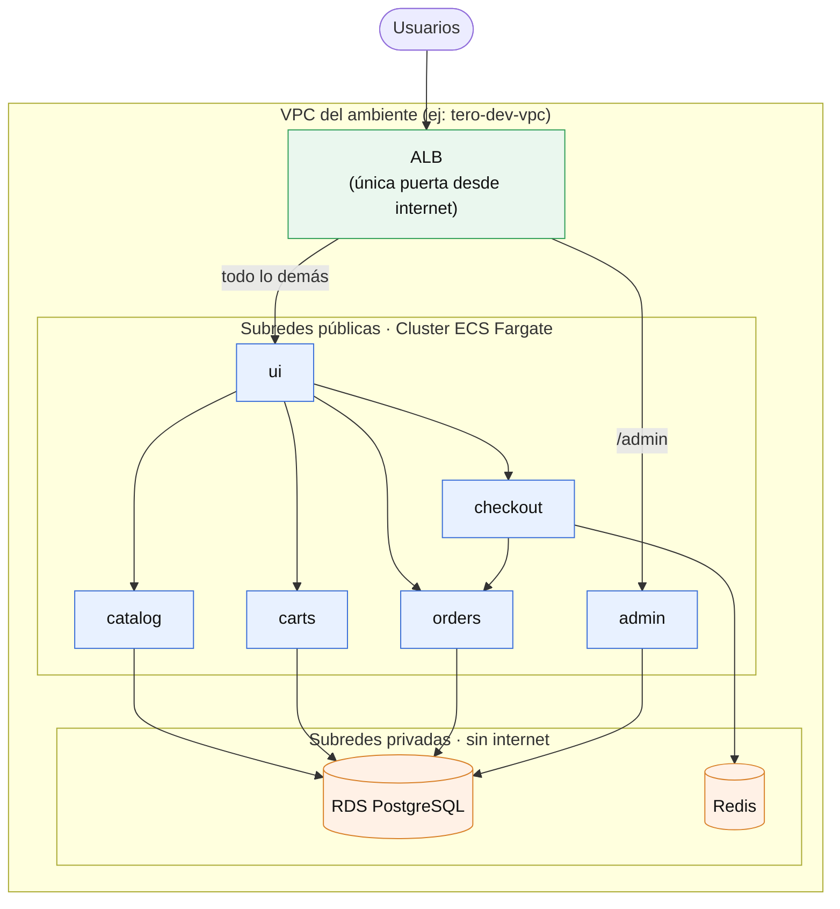
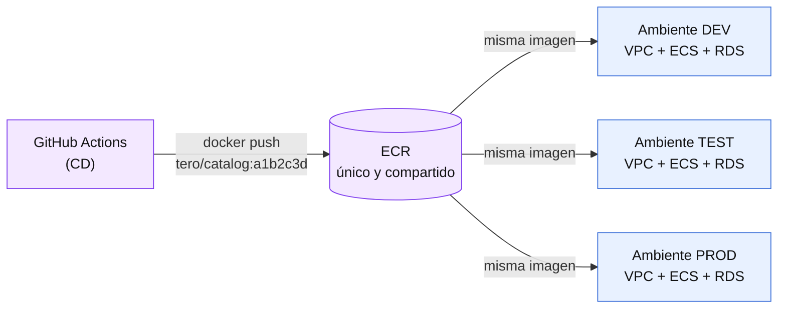
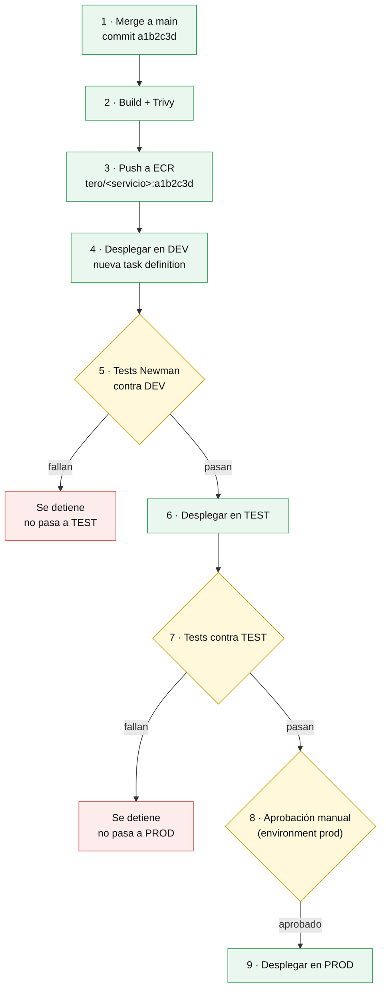
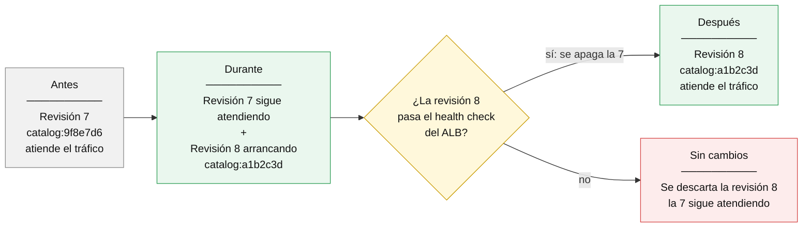

# Despliegue en ECS

Diagramas del despliegue de Tero en AWS (ECS Fargate + ECR). GitHub los dibuja automáticamente a partir del código Mermaid.

## 1. Tero corriendo en un ambiente

- El **ALB** es la única entrada desde internet: `/admin` va al panel y el resto a la tienda (`ui`).
- Los servicios se llaman entre sí por nombre (`http://catalog:8080`), como en `docker compose`.
- RDS y Redis están en subredes privadas y solo aceptan conexiones de las tareas de ECS.

## 2. Un ECR para los tres ambientes

La imagen se construye una sola vez y la misma (mismo tag) se despliega en dev, test y prod.

## 3. Flujo de despliegue con quality gates

## 4. Despliegue gradual dentro de un ambiente

ECS levanta la versión nueva junto a la anterior y solo apaga la vieja cuando la nueva pasa el health check del ALB. Si falla, la versión anterior sigue atendiendo, sin cortes.

## 5. Los tres ambientes

Un **ambiente** es una copia completa e independiente de Tero (red, servicios y base de datos). Los cambios avanzan de uno al siguiente solo si pasan los controles:

| Ambiente | Para qué sirve | Si se rompe... |
|---|---|---|
| **Dev** | Ver rápido si el cambio funciona. Se despliega automáticamente al mergear | No afecta a nadie |
| **Test** | Probar a fondo en un entorno igual a producción | Ningún cliente se entera |
| **Prod** | La tienda real que usan los clientes | Se pierden ventas |

### Por qué la misma imagen en los tres

La imagen se construye **una sola vez**, se publica en ECR con el tag del commit, y **esa misma** se despliega en dev, test y prod (*build once, promote many*). Así, lo que llega a producción es exactamente lo que pasó las pruebas. Si se reconstruyera en cada ambiente, la imagen base, las dependencias o el código podrían cambiar entre un build y otro, y prod correría algo que nunca se probó.

- **ECR guarda** las imágenes (un único registro, tags inmutables).
- **ECS las ejecuta**: el ECS de cada ambiente descarga la imagen al desplegarse en ese ambiente.
- La imagen avanza de a un ambiente: si los tests fallan en dev, test y prod nunca la descargan.

En un momento dado, cada ambiente puede correr una versión distinta, y el tag (SHA del commit) dice exactamente cuál:

| Ambiente | Ejemplo |
|---|---|
| Dev | `catalog:a1b2c3d` (lo último mergeado) |
| Test | `catalog:9f8e7d6` (ya validada en dev) |
| Prod | `catalog:5c4b3a2` (la última aprobada) |

### Qué cambia entre ambientes

El código (la imagen) es igual; cambia la **configuración**, definida en los `tfvars` de cada ambiente:

| Qué | ¿Igual en los tres? |
|---|---|
| Imagen | ✅ Sí |
| Base de datos a la que se conecta | ❌ No |
| Contraseñas (Secrets Manager) | ❌ No |
| Red (`10.10`, `10.20`, `10.30`) | ❌ No |
| Tamaño y cantidad de tareas | ❌ No |

## 6. Fargate: sin nodos que administrar

Con **ECS Fargate** no hay servidores (nodos) que crear ni mantener: se indica cuánta CPU y memoria necesita cada contenedor y AWS lo ejecuta. Se paga solo por lo que usa cada tarea mientras corre.

| Concepto | Qué es | Cantidad |
|---|---|---|
| **Cluster** | Agrupación lógica de todo lo de un ambiente (no es una máquina) | 1 por ambiente |
| **Servicio** | Uno por microservicio; mantiene corriendo la cantidad de copias indicada | 6 por ambiente |
| **Tarea** | Una copia del contenedor en ejecución (lo que tiene costo) | 1 o más por servicio |

| Ambiente | Cluster | Servicios | Tareas |
|---|---|---|---|
| Dev | `tero-dev` | 6 | 6 |
| Test | `tero-test` | 6 | 6 |
| Prod | `tero-prod` | 6 | 6 (12 con 2 copias por servicio) |

En producción conviene **2 tareas por servicio**, una en cada zona de disponibilidad, para que si una falla la otra siga atendiendo. Por el presupuesto de Learner Lab se puede usar 1 y documentar que en una cuenta productiva serían 2 (`desired_count` en los `tfvars`).

### Cuidado con el presupuesto

Cada tarea, cada base RDS y cada ALB cobran por hora mientras existen. Por eso:

- Tamaño mínimo de tarea (0,25 CPU y 512 MB) en dev y test.
- Crear test y prod solo cuando se necesiten (pruebas o demo) y borrarlos con `terraform destroy`.
- Borrar dev al terminar el día de trabajo.
