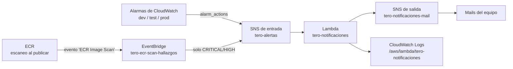

# Notificaciones (Lambda + SNS)

Este es el servicio serverless del proyecto (letra, sección 7.2). Su propósito es de
**observabilidad y seguridad**: avisarle al equipo por mail cuando algo sale mal, sin que
nadie tenga que estar mirando la consola de AWS.

Avisa de dos cosas:

| Evento | De dónde sale | Por qué importa |
| ------ | ------------- | --------------- |
| Una alarma de CloudWatch pasa a `ALARM` (y avisa también cuando vuelve a `OK`) | Alarmas del issue #25 (disponibilidad, errores) | Disponibilidad y rendimiento |
| ECR termina de escanear una imagen y encuentra vulnerabilidades `CRITICAL` o `HIGH` | Escaneo al publicar de ECR (`scan_on_push`), a través de EventBridge | Seguridad |

## Arquitectura



| Pieza | Para qué |
| ----- | -------- |
| **SNS `tero-alertas`** (entrada) | Es el buzón único. Cualquier alarma o evento que quiera avisar al equipo publica acá. Lo que llega es el JSON de AWS, sin formato. |
| **EventBridge `tero-ecr-scan-hallazgos`** | Escucha los eventos de escaneo de ECR y deja pasar solo los que tienen hallazgos `CRITICAL` o `HIGH` (el mismo criterio que Trivy en el CI), para no hacer ruido. |
| **Lambda `tero-notificaciones`** (Python 3.12) | Convierte el JSON en un mail legible: un asunto claro (`[ALARM] tero-dev-...`, `[ECR] Vulnerabilidades en ...`) y un texto con qué pasó, el motivo y el link a la consola. No tiene dependencias: usa solo la librería estándar y boto3. |
| **SNS `tero-notificaciones-mail`** (salida) | Manda el texto ya formateado a cada mail suscrito (variable `alert_emails`). |
| **CloudWatch Logs** | Cada aviso queda también en los logs de la Lambda durante 14 días. Sirve de evidencia y para depurar. |

## Decisiones

- **Mail con SNS, sin SES.** Las suscripciones de mail de SNS funcionan en el Learner Lab, no
  necesitan verificar un dominio ni salir del *sandbox* de SES y son lo que muestra el lab
  T10/01. Cada dirección tiene que confirmar la suscripción una vez, desde el mail que manda AWS.
- **Por qué hay Lambda y no mails directo desde `tero-alertas`.** Si se suscribe un mail
  directamente al topic de entrada, el aviso de ECR llega como un JSON crudo y cada fuente
  tiene un formato distinto. La Lambda unifica todo en un asunto y un texto que se leen de un
  vistazo, y además agrega el link a la consola.
- **Raíz compartida (`infra/shared/`), no por ambiente.** ECR es uno solo para los tres
  ambientes: si la regla de ECR estuviera en cada uno, cada escaneo avisaría tres veces.
  Además las notificaciones siguen funcionando aunque se destruya dev para ahorrar crédito. Las
  alarmas de cada ambiente llevan el ambiente en el nombre (`tero-dev-...`), así se sabe de
  dónde vienen.
- **Los mails no están en el repo.** El repositorio es público, así que las direcciones van en
  `infra/shared/terraform.tfvars`, que está en `.gitignore`. Hay un ejemplo en
  `terraform.tfvars.example`.
- **LabRole.** El Learner Lab no deja crear roles de IAM. LabRole ya permite escribir logs y
  publicar en SNS (es el mismo rol que usa ECS).
- **Lambda fuera de la VPC.** No accede a la base y llama a la API de SNS por Internet. Dentro
  de la VPC haría falta un NAT Gateway (que se paga por hora) sin ningún beneficio.
- **Topics SNS sin cifrado KMS.** Con la clave administrada de AWS (`aws/sns`), CloudWatch y
  EventBridge no pueden publicar, y una clave propia cuesta USD 1 por mes. Los mensajes no
  llevan datos sensibles: son nombres de alarmas e imágenes.

## Puesta en marcha

```bash
cd infra/shared
cp terraform.tfvars.example terraform.tfvars   # y poner los mails del equipo
terraform init      # descarga el proveedor "archive", que arma el zip de la Lambda
terraform plan      # tiene que mostrar solo recursos nuevos; nada de ECR cambia
terraform apply
terraform output
```

A cada dirección le llega un mail **"AWS Notification - Subscription Confirmation"**. Hasta
que se hace clic en *Confirm subscription*, a esa dirección no le llega nada. Para ver el estado:

```bash
aws sns list-subscriptions-by-topic \
  --topic-arn "$(terraform output -raw notificaciones_mail_topic_arn)" \
  --query "Subscriptions[].[Endpoint,SubscriptionArn]" --output table
# "PendingConfirmation" = falta hacer clic en el mail
```

Para agregar o sacar a alguien: editar `terraform.tfvars` y volver a correr `terraform apply`.

> Quien haga el apply de `infra/shared/` tiene que tener el `terraform.tfvars` con los mails.
> Sin ese archivo, la lista queda vacía y Terraform borra las suscripciones.

## Cómo usarlo desde otras alarmas (issue #25)

Desde `infra/` (la raíz por ambiente) se busca el topic de entrada por nombre:

```hcl
data "aws_sns_topic" "alertas" {
  name = "tero-alertas"
}

resource "aws_cloudwatch_metric_alarm" "ejemplo" {
  alarm_name    = "${local.name}-..."
  # ...
  alarm_actions = [data.aws_sns_topic.alertas.arn]
  ok_actions    = [data.aws_sns_topic.alertas.arn] # avisa también cuando se resuelve
}
```

## Probar

```bash
cd infra/modules/notifications/eventos-prueba
TOPIC=$(terraform -chdir=../../../shared output -raw alertas_sns_topic_arn)

# Simula una alarma y un escaneo de ECR (recorren SNS -> Lambda -> SNS -> mail)
aws sns publish --topic-arn "$TOPIC" --message file://alarma.json
aws sns publish --topic-arn "$TOPIC" --message file://escaneo-ecr.json

# Ver qué hizo la Lambda
aws logs tail /aws/lambda/tero-notificaciones --since 10m
```

Prueba con una alarma real de CloudWatch (se fuerza el estado y después se borra la alarma):

```bash
aws cloudwatch put-metric-alarm --alarm-name tero-prueba-notificaciones \
  --namespace AWS/Lambda --metric-name Errors --statistic Sum --period 60 \
  --evaluation-periods 1 --threshold 1 --comparison-operator GreaterThanOrEqualToThreshold \
  --dimensions Name=FunctionName,Value=tero-notificaciones --alarm-actions "$TOPIC"
aws cloudwatch set-alarm-state --alarm-name tero-prueba-notificaciones \
  --state-value ALARM --state-reason "Prueba del issue #23"
aws cloudwatch delete-alarms --alarm-names tero-prueba-notificaciones
```

El camino real de ECR se ve cuando el pipeline de CD publica una imagen. ECR escanea sin
`--ignore-unfixed`, así que puede avisar de vulnerabilidades que Trivy deja pasar en el CI
porque todavía no tienen parche: es la "segunda capa".

## Qué hacer ante cada aviso

| Mail | Qué hacer |
| ---- | --------- |
| `[ALARM] ...` | Abrir el link de la alarma, mirar la métrica y seguir el runbook de esa alarma ([observabilidad.md](observabilidad.md#procedimientos-de-respuesta-runbooks)). |
| `[OK] ...` | Se resolvió sola o por la acción que se tomó. Dejar registro si hubo impacto. |
| `[ECR] Vulnerabilidades en ...` | Abrir el link de ECR y ver los CVE. Si tienen parche, actualizar la imagen base o la dependencia y volver a publicar. Si no lo tienen, evaluar el riesgo antes de promover la imagen a test o prod. |
| No llegan mails | 1) `aws logs tail /aws/lambda/tero-notificaciones`: si dice "Publicado en el topic de mail", la Lambda anduvo. 2) Ver si la suscripción está en `PendingConfirmation`. 3) Buscar en la carpeta de spam. |

## Análisis con Checkov (lab T09/05)

Con `checkov -d infra/modules/notifications` pasan 6 controles y fallan 10. Los que fallan se
aceptaron a propósito:

| Control | Motivo |
| ------- | ------ |
| CKV_AWS_26 (×2) SNS cifrado | Ver la decisión "Topics SNS sin cifrado KMS". |
| CKV_AWS_158 / CKV_AWS_173 KMS propio en logs y variables | Ya se cifran con claves administradas por AWS. Una CMK tiene costo, y la variable de entorno es solo el ARN de un topic. |
| CKV_AWS_338 logs por 1 año | 14 días alcanzan para depurar y no acumulan costo en el Learner Lab. |
| CKV_AWS_117 Lambda en VPC | Ver la decisión "Lambda fuera de la VPC". |
| CKV_AWS_116 DLQ | SNS reintenta la invocación y los errores quedan en los logs. Un DLQ es una mejora posible. |
| CKV_AWS_115 concurrencia reservada | El Learner Lab tiene un límite de concurrencia muy bajo y reservar puede fallar. Además, el volumen de alertas es mínimo. |
| CKV_AWS_272 firma de código | Requiere AWS Signer y queda fuera del alcance. |
| CKV_AWS_50 X-Ray | La Lambda hace una sola llamada, así que no aporta trazas útiles. |

## Costo

Es prácticamente cero: Lambda, SNS (incluidos los mails) y EventBridge tienen una capa
gratuita mucho mayor que lo que usa el proyecto. Se puede dejar levantado.
