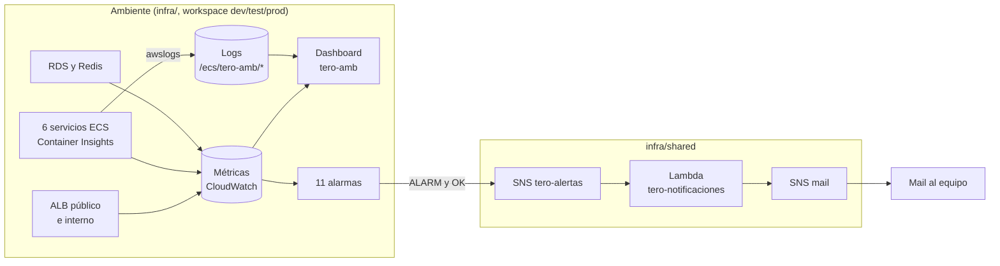

# Observabilidad: dashboard, alarmas y logs

Issues #24 y #25. Cubre la sección 8 de la letra: ver el estado del sistema en producción
(y en dev/test), con métricas, logs centralizados, **1 dashboard** y **alarmas con su
condición de disparo y su procedimiento de respuesta**.

Se usa **Amazon CloudWatch**, la herramienta del laboratorio T10/01 del curso
(métricas, Logs Insights, dashboards y alarmas con SNS). Prometheus + Grafana (T10/02) está
pensado para Kubernetes; Tero corre en ECS, donde AWS ya publica las métricas en CloudWatch
sin instalar nada.

## Qué hay y dónde

| Pieza | Dónde se define | Qué hace |
| ----- | --------------- | -------- |
| Métricas de los servicios (CPU, memoria, tareas corriendo) | `infra/ecs.tf` (Container Insights) | ECS las publica solo en `AWS/ECS` y `ECS/ContainerInsights` |
| Métricas de la aplicación (pedidos, errores, latencia) | Las publica el ALB solo | `AWS/ApplicationELB`, por ALB y por target group |
| Métricas de la base y de Redis | Las publican RDS y ElastiCache solos | `AWS/RDS`, `AWS/ElastiCache` |
| Logs centralizados | `infra/modules/ecs-service` (driver `awslogs`) | Un grupo por servicio: `/ecs/tero-<amb>/<servicio>`, 7 días |
| Consultas de logs guardadas | `infra/modules/observability/logs.tf` | Logs Insights → Queries → carpeta `tero-<amb>` |
| Dashboard | `infra/modules/observability/dashboard.tf` | `tero-<amb>` en CloudWatch → Dashboards |
| Alarmas | `infra/modules/observability/alarms.tf` | 11 por ambiente, avisan a `tero-alertas` |
| Aviso por mail | `infra/shared` (issue #23) | SNS `tero-alertas` → Lambda → mail ([notificaciones.md](notificaciones.md)) |

Todo se crea con el `terraform apply` del ambiente (`infra/`), el mismo que corre el CD.
El link al dashboard sale en `terraform output dashboard_url`.



## El dashboard

Se lee de arriba hacia abajo, como las preguntas que uno se hace ante un problema:

| Fila | Pregunta | Widgets |
| ---- | -------- | ------- |
| 1 | ¿Hay algo sonando? | Estado de las 11 alarmas (verde/rojo) |
| 2 | ¿Qué ven los usuarios? | Pedidos por minuto, errores 5xx/4xx, tiempo de respuesta p50 y p95 |
| 3 | ¿Están vivos los servicios? | Tareas sanas por servicio (ALB) y tareas corriendo (Container Insights) |
| 4 | ¿Les alcanzan los recursos? | CPU y memoria de cada servicio, con la línea del umbral de la alarma |
| 5 | ¿Cómo están los datos? | RDS (CPU, conexiones, espacio libre) y Redis (CPU, memoria, conexiones) |
| 6 | ¿Qué dicen los logs? | Líneas de error por servicio y los últimos 50 errores de todos los servicios |

Son las "señales doradas" de un servicio: **tráfico, errores, latencia y saturación**.

## Las alarmas

Todas avisan **al entrar en ALARM y al volver a OK** (`alarm_actions` y `ok_actions`).
Los umbrales son variables del módulo (`infra/modules/observability/variables.tf`).

| Alarma | Tipo | Trigger (condición de disparo) | Por qué este umbral |
| ------ | ---- | ------------------------------ | ------------------- |
| `tero-<amb>-<servicio>-sin-tareas-sanas` (6, una por servicio) | Disponibilidad | `HealthyHostCount` mínimo `< 1` durante **3 minutos seguidos**. Si la métrica no llega, cuenta como caído | Cada servicio corre 1 tarea: 0 sanas = servicio caído. 3 min evita avisar por un reinicio rápido |
| `tero-<amb>-errores-5xx` | Rendimiento | Más del **5 %** de los pedidos al ALB público terminan en 5xx (del servicio o del ALB), en **2 ventanas de 5 min seguidas**, solo si hubo **10 pedidos o más** | Con poco tráfico 1 error sería un 50 %: el mínimo evita falsas alarmas |
| `tero-<amb>-latencia-alta` | Rendimiento | `TargetResponseTime` **p95 > 2 s** en 2 ventanas de 5 min seguidas | p95 en vez de promedio: el promedio esconde a los usuarios que esperan mucho |
| `tero-<amb>-cpu-alta` | Recursos | El servicio que más CPU usa pasa el **80 %** en 2 ventanas de 5 min (`MAX` de los 6) | Por encima del 80 % sostenido el servicio empieza a responder lento |
| `tero-<amb>-memoria-alta` | Recursos | El servicio que más memoria usa pasa el **85 %** en 2 ventanas de 5 min | Si llega al 100 % ECS mata la tarea (OOM) |
| `tero-<amb>-admin-accesos-rechazados` | Seguridad | Más de **20 respuestas 4xx** del panel de administración en 5 minutos | El admin responde 401 si la contraseña es incorrecta: muchos seguidos pueden ser fuerza bruta |

Además, desde el issue #23, llega un mail si ECR encuentra vulnerabilidades CRITICAL o HIGH
en una imagen publicada (seguridad).

> Al levantar un ambiente es normal que lleguen avisos `[ALARM] ...-sin-tareas-sanas` y a los
> pocos minutos `[OK]`: las alarmas existen antes de que las tareas terminen de arrancar.

## Procedimientos de respuesta (runbooks)

Pasos comunes al recibir cualquier mail `[ALARM]`:

1. Abrir el link del mail y el **dashboard** del ambiente (`terraform output dashboard_url`).
2. Ver si es un solo servicio o varios a la vez (fila 3 y 4 del dashboard).
3. Ver si coincide con un deploy reciente: GitHub → Actions → CD.
4. Seguir el runbook de la alarma. Cuando llegue el `[OK]`, dejar una línea de qué pasó en el issue o en el canal del equipo.

### Servicio caído

`tero-<amb>-<servicio>-sin-tareas-sanas`

1. Ver los eventos del servicio (por qué se paró la tarea):
   ```bash
   aws ecs describe-services --cluster tero-<amb>-cluster --services <servicio> \
     --query 'services[0].{deseadas:desiredCount,corriendo:runningCount,eventos:events[:5].message}'
   ```
2. Ver los últimos logs del servicio:
   ```bash
   aws logs tail /ecs/tero-<amb>/<servicio> --since 15m
   ```
3. Según lo que diga:
   - **No conecta a la base o a Redis**: revisar que RDS/Redis estén `available` (fila 5 del dashboard) y el secreto en Secrets Manager.
   - **Falla el health check** (`/health` no responde 200): revisar el log de arranque.
   - **Se fue de memoria** (`OutOfMemoryError` o `exit code 137`): ver [CPU o memoria alta](#cpu-o-memoria-alta).
   - **Después de un deploy**: el circuit breaker ya vuelve solo a la versión anterior. Si no, volver a la versión anterior con `terraform apply -var image_tag=<tag-anterior>` ([despliegue-ecs.md](despliegue-ecs.md)).
4. Si no se encuentra la causa y hay que recuperar rápido: forzar tareas nuevas.
   ```bash
   aws ecs update-service --cluster tero-<amb>-cluster --service <servicio> --force-new-deployment
   ```

### Errores 5xx

`tero-<amb>-errores-5xx`

1. En el dashboard (fila 2), ver si los 5xx son **del ALB** (503: no tiene a quién mandar el pedido → casi seguro hay un servicio caído, ver la alarma de arriba) o **de los servicios** (500: el código falla).
2. Buscar el error en los logs: Logs Insights → Queries → `tero-<amb>/errores-todos-los-servicios`.
3. Para catalog y orders, la consulta `tero-<amb>/respuestas-http-catalog-orders` muestra qué ruta devuelve 5xx.
4. Si empezó con un deploy, volver a la versión anterior (`image_tag`). Si es la base, ver la fila 5 del dashboard.

### Latencia alta

`tero-<amb>-latencia-alta`

1. Ver si coincide con CPU alta (fila 4) o con mucha más cantidad de pedidos (fila 2). Si es así: es falta de capacidad, ver el runbook siguiente.
2. Ver la CPU y las conexiones de la base (fila 5): una base lenta hace lentos a todos.
3. Ver qué servicio tarda: consulta `respuestas-http-catalog-orders` (columna de latencia en los logs de Gin) y logs de checkout (`... 200 <tiempo>ms`).

### CPU o memoria alta

`tero-<amb>-cpu-alta` o `tero-<amb>-memoria-alta`

1. En el dashboard (fila 4) ver **qué servicio** es.
2. Si es por más tráfico (fila 2 sube a la vez): subir la cantidad de tareas como arreglo rápido.
   ```bash
   aws ecs update-service --cluster tero-<amb>-cluster --service <servicio> --desired-count 2
   ```
   y después dejarlo fijo en Terraform (`desired_count` o más `cpu`/`memory` en `infra/services.tf`),
   porque el próximo `terraform apply` vuelve a lo que diga el código.
3. Si el tráfico es normal y la memoria sube sin parar: puede ser una pérdida de memoria en el
   código. Reiniciar con `--force-new-deployment` y abrir un issue con la evidencia del dashboard.

### Accesos rechazados al admin

`tero-<amb>-admin-accesos-rechazados`

1. Ver si alguien del equipo estaba probando (por ejemplo, el test de Newman o una demo).
2. Ver los pedidos al admin en el dashboard (fila 2, 4xx) y desde qué IPs vienen: los logs del ALB
   no están activados, así que se mira en los logs de admin y en la cantidad de 4xx.
3. Si es un ataque: cambiar la contraseña del admin (secreto `tero-<amb>/admin` en Secrets Manager,
   y `--force-new-deployment` del servicio admin para que la lea) y evaluar restringir `/admin` por IP
   en el security group del ALB.

## Buscar en los logs (Logs Insights)

CloudWatch → **Logs Insights** → **Queries** (panel derecho) → carpeta `tero-<amb>`:

| Consulta | Para qué |
| -------- | -------- |
| `errores-todos-los-servicios` | Líneas con error, exception, fatal o panic en los 6 servicios, la más nueva primero |
| `actividad-por-servicio` | Cuántas líneas escribe cada servicio cada 5 min (si uno deja de escribir, algo pasa) |
| `respuestas-http-catalog-orders` | Pedidos por código HTTP, método y ruta en catalog y orders (líneas de Gin) |

También desde la terminal, como en el lab:

```bash
aws logs tail /ecs/tero-dev/catalog --since 10m
aws logs filter-log-events --log-group-name /ecs/tero-dev/checkout --filter-pattern "ERROR"
```

**Limitación conocida:** los servicios escriben logs de texto (cada uno con el formato de su
framework), no JSON. Igual se pueden buscar y filtrar (Logs Insights extrae campos con `parse`),
pero un formato JSON común necesitaría cambiar el código de los 6 servicios.

## Probarlo

Con el ambiente levantado (por ejemplo dev) y `cd infra`:

```bash
terraform output dashboard_url
terraform output alarm_names
APP=$(terraform output -raw app_url)
```

1. **Disponibilidad (alarma real):** bajar catalog a 0 tareas. A los ~3 minutos llega
   `[ALARM] tero-dev-catalog-sin-tareas-sanas`.
   ```bash
   aws ecs update-service --cluster tero-dev-cluster --service catalog --desired-count 0
   ```
2. **Errores 5xx:** con catalog abajo, generar tráfico a la tienda. En ~10 minutos llega
   `[ALARM] tero-dev-errores-5xx`.
   ```bash
   for i in $(seq 1 300); do curl -s -o /dev/null -w "%{http_code}\n" "$APP/api/catalog/products"; sleep 2; done
   ```
3. Volver a subir catalog y esperar los `[OK]`:
   ```bash
   aws ecs update-service --cluster tero-dev-cluster --service catalog --desired-count 1
   ```
4. **Seguridad:** 30 logins incorrectos al admin. A los ~5 minutos llega
   `[ALARM] tero-dev-admin-accesos-rechazados`.
   ```bash
   for i in $(seq 1 30); do curl -s -o /dev/null -w "%{http_code}\n" -X POST "$APP/auth/login" \
     -H 'Content-Type: application/json' -d '{"username":"admin","password":"mal"}'; done
   ```
5. Cualquier alarma se puede forzar para ver el mail sin romper nada:
   ```bash
   aws cloudwatch set-alarm-state --alarm-name tero-dev-latencia-alta \
     --state-value ALARM --state-reason "Prueba manual"
   ```

## Costos

En una cuenta normal: los 3 primeros dashboards son gratis, cada alarma cuesta USD 0,10 por mes
por métrica (las de metric math usan varias) y las consultas de Logs Insights se cobran por GB
leído. Como los ambientes del Learner Lab se levantan solo para probar y después se destruyen,
el costo es de centavos. El `terraform destroy` del ambiente borra también el dashboard y las alarmas.
