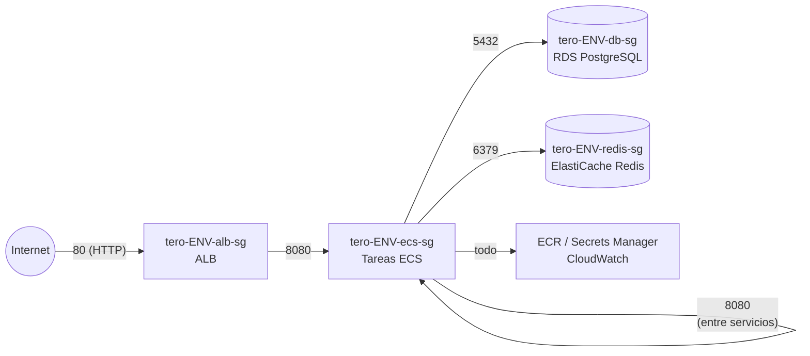

## Security groups

Cada componente tiene su propio security group (un "portero" con la lista de quién puede entrar y a dónde puede salir). Se definen en el módulo reutilizable `infra/modules/security`.

### Flujo de tráfico permitido

### Reglas

| Security group | Entrada (ingress)                        | Salida (egress)         |
| -------------- | ---------------------------------------- | ----------------------- |
| `alb-sg`       | TCP 80 desde `0.0.0.0/0`                 | TCP 8080 hacia `ecs-sg` |
| `ecs-sg`       | TCP 8080 desde `alb-sg` y desde `ecs-sg` | Todo hacia `0.0.0.0/0`  |
| `db-sg`        | TCP 5432 desde `ecs-sg`                  | Ninguna                 |
| `redis-sg`     | TCP 6379 desde `ecs-sg`                  | Ninguna                 |

### Decisiones

- **Reglas entre security groups, no entre IPs.** Las reglas usan `referenced_security_group_id`: "dejá entrar a quien tenga el security group X". En Fargate las tareas cambian de IP en cada reinicio, así que las reglas por IP se romperían.
- **La base de datos y Redis no son accesibles desde internet.** Viven en subredes privadas y su único origen permitido es `ecs-sg`. Esto resuelve la observación del auditor: _"La base de datos y Redis están publicados en puertos de la máquina anfitriona"_.
- **`db-sg` y `redis-sg` no tienen reglas de salida.** Los security groups son _stateful_: las respuestas a una conexión permitida vuelven solas. Al crear el security group, Terraform elimina la regla de salida abierta que AWS agrega por defecto.
- **ECS tiene la salida abierta.** Las tareas tienen que llegar a servicios de AWS fuera de la VPC (ECR para bajar imágenes, Secrets Manager, CloudWatch Logs), y estos no tienen IPs fijas. Una mejora futura sería usar VPC Endpoints y restringir la salida.
- **Un único `ecs-sg` para todos los servicios.** Es más simple de operar. La contra es que cualquier servicio puede llamar a cualquier otro. Separar un security group por servicio queda como mejora futura.
- **Descripciones sin tildes.** AWS rechaza tildes y ñ en las descripciones de security groups y de sus reglas.

### Evidencia

AGREGAR EVI
