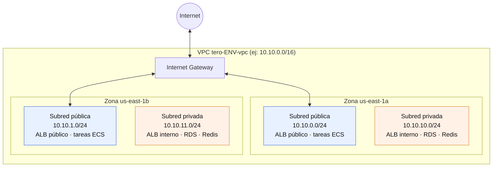
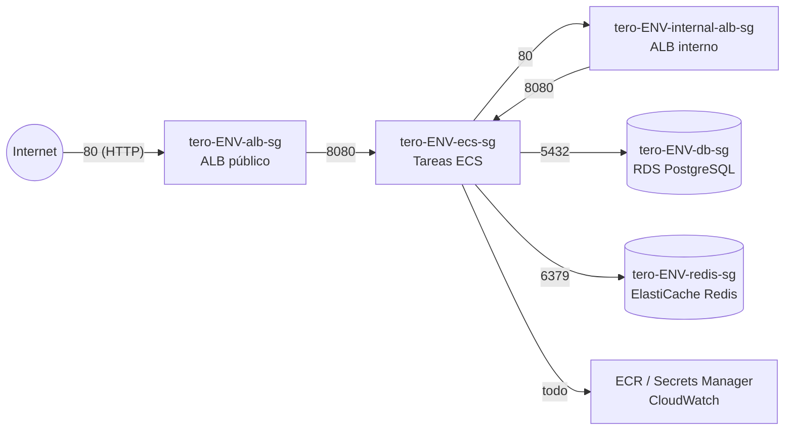

# Red y security groups

Código Terraform:

| Qué | Dónde |
|---|---|
| VPC, subredes, Internet Gateway, tablas de rutas | `infra/modules/network` |
| Security groups y sus reglas | `infra/modules/security` |
| CIDR de cada ambiente | `infra/envs/<env>.tfvars` (`vpc_cidr`) |

## 1. La red de un ambiente

Cada ambiente (dev, test, prod) tiene **su propia VPC**, separada de las otras, con subredes en **2 zonas de disponibilidad** (`us-east-1a` y `us-east-1b`): si una zona falla, la otra sigue funcionando.

| Tipo de subred | Ruta a internet | Qué vive ahí |
|---|---|---|
| **Pública** | Sí, por el Internet Gateway | ALB público y las tareas de ECS |
| **Privada** | **No** (su tabla de rutas no tiene salida) | ALB interno, RDS y Redis |

### CIDR por ambiente

| Ambiente | VPC | Subredes públicas | Subredes privadas |
|---|---|---|---|
| dev | `10.10.0.0/16` | `10.10.0.0/24`, `10.10.1.0/24` | `10.10.10.0/24`, `10.10.11.0/24` |
| test | `10.20.0.0/16` | `10.20.0.0/24`, `10.20.1.0/24` | `10.20.10.0/24`, `10.20.11.0/24` |
| prod | `10.30.0.0/16` | `10.30.0.0/24`, `10.30.1.0/24` | `10.30.10.0/24`, `10.30.11.0/24` |

Las subredes se calculan solas a partir del CIDR de la VPC con `cidrsubnet`: las públicas usan los bloques 0 y 1, y las privadas el 10 y el 11. Los rangos no se pisan entre ambientes, por si en el futuro se conectan entre sí.

### Decisiones de red

- **Sin NAT Gateway.** El NAT Gateway se cobra por hora (y por tráfico), y el presupuesto del Learner Lab es limitado. Sin NAT, las subredes privadas no tienen salida a internet. Como consecuencia:
  - RDS, Redis y el ALB interno van en las privadas: **no necesitan internet**.
  - Las tareas de ECS van en las **públicas, con IP pública** (`assign_public_ip = true`), porque necesitan salir a internet para bajar la imagen de ECR y leer Secrets Manager. No quedan expuestas: su security group solo acepta tráfico de los dos ALB (ver sección 2).
  - Mejora en una cuenta real: NAT Gateway (o VPC Endpoints de ECR, Secrets Manager y CloudWatch) y mover las tareas a las subredes privadas.
- **Una VPC por ambiente.** Un error en dev no puede afectar a prod.
- **DNS habilitado en la VPC** (`enable_dns_support` y `enable_dns_hostnames`), necesario para resolver las direcciones de RDS, Redis y los ALB.

## 2. Security groups

Cada componente tiene su propio security group (un "portero" con la lista de quién puede entrar y a dónde puede salir). Se definen en el módulo reutilizable `infra/modules/security`.

### Flujo de tráfico permitido

### Reglas

| Security group | Entrada (ingress) | Salida (egress) |
|---|---|---|
| `alb-sg` | TCP 80 desde `0.0.0.0/0` | TCP 8080 hacia `ecs-sg` |
| `internal-alb-sg` | TCP 80 **solo desde `ecs-sg`** | TCP 8080 hacia `ecs-sg` |
| `ecs-sg` | TCP 8080 desde `alb-sg` y desde `internal-alb-sg` | Todo hacia `0.0.0.0/0` |
| `db-sg` | TCP 5432 desde `ecs-sg` | Ninguna |
| `redis-sg` | TCP 6379 desde `ecs-sg` | Ninguna |

### Quién puede hablar con quién

| Origen → destino | ¿Permitido? | Por qué |
|---|---|---|
| Internet → ALB público | ✅ | Es la única puerta de entrada |
| Internet → tareas ECS, ALB interno, RDS o Redis | ❌ | Ninguna regla lo permite |
| ALB público → ui, admin | ✅ | `ecs-sg` acepta desde `alb-sg` |
| ui, checkout → ALB interno | ✅ | `internal-alb-sg` acepta desde `ecs-sg` |
| ALB interno → catalog, carts, checkout, orders | ✅ | `ecs-sg` acepta desde `internal-alb-sg` |
| Un servicio → otro servicio, directo | ❌ | Se eliminó la regla `ecs-sg` → `ecs-sg`: todo pasa por el ALB interno |
| Tareas ECS → RDS / Redis | ✅ | `db-sg` y `redis-sg` aceptan desde `ecs-sg` |

### Decisiones

- **Reglas entre security groups, no entre IPs.** Las reglas usan `referenced_security_group_id`: "dejá entrar a quien tenga el security group X". En Fargate las tareas cambian de IP en cada reinicio, así que las reglas por IP se romperían.
- **La base de datos y Redis no son accesibles desde internet.** Viven en subredes privadas y su único origen permitido es `ecs-sg`. Esto resuelve la observación del auditor: _"La base de datos y Redis están publicados en puertos de la máquina anfitriona"_.
- **ALB interno con su propio security group.** Reemplaza a Service Connect, que el Learner Lab no permite (ver `despliegue-ecs.md`). Solo acepta tráfico de las tareas de ECS, así que no se puede usar desde internet.
- **Sin tráfico directo entre servicios.** Toda llamada entre servicios pasa por el ALB interno, que la balancea, controla la salud de cada servicio y la registra en sus métricas.
- **`db-sg` y `redis-sg` no tienen reglas de salida.** Los security groups son _stateful_: las respuestas a una conexión permitida vuelven solas. Al crear el security group, Terraform elimina la regla de salida abierta que AWS agrega por defecto.
- **ECS tiene la salida abierta.** Las tareas tienen que llegar a servicios de AWS fuera de la VPC (ECR para bajar imágenes, Secrets Manager, CloudWatch Logs), y estos no tienen IPs fijas. Mejora: VPC Endpoints y restringir la salida.
- **Un único `ecs-sg` para todos los servicios.** Es más simple de operar. Separar un security group por servicio (por ejemplo, que solo admin, catalog, carts y orders lleguen a RDS) queda como mejora.
- **Descripciones sin tildes.** AWS rechaza tildes y ñ en las descripciones de security groups y de sus reglas.

## Evidencia

